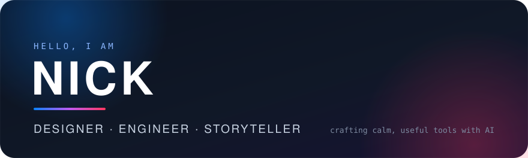
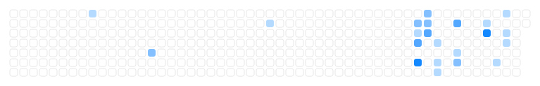

 

I build calm, useful things where **design meets AI** — AI-native workflows, macOS tools, and visual content people actually enjoy reading.

设计 × 工程 × 叙事

 

## ✦ Focus

<table width="100%" cellspacing="0" style="border-collapse: collapse">
  <tr>
    <td width="33%" style="padding: 4px 24px 4px 0; vertical-align: top">
      <b style="font-size: 15px">Design</b> 
      视觉内容 · 排版 公众号 · 小红书 · PPT
    </td>
    <td width="33%" style="padding: 4px 24px 4px 0; vertical-align: top">
      <b style="font-size: 15px">Engineering</b> 
      AI 工具生态 macOS 工具 · Skill 开发
    </td>
    <td width="33%" style="padding: 4px 0; vertical-align: top">
      <b style="font-size: 15px">Storytelling</b> 
      AI 工作流教程 产品文档 · 经验分享
    </td>
  </tr>
</table>

 

## ✦ Selected Work

<table width="100%" cellspacing="0" style="border-collapse: collapse">
  <tr>
    <td style="padding: 10px 16px 10px 0; border-bottom: 1px solid rgba(128,128,128,0.18); white-space: nowrap"><a href="https://github.com/Nick-Job/vertical-split-postcard" style="color: inherit; text-decoration: none; font-weight: 600">vertical-split-postcard</a></td>
    <td style="padding: 10px 0; border-bottom: 1px solid rgba(128,128,128,0.18); color: #86868b; font-size: 13.5px">Codex skill — 上图下画的竖版分栏明信片</td>
    <td align="right" style="padding: 10px 0 10px 16px; border-bottom: 1px solid rgba(128,128,128,0.18); color: #86868b; font-size: 13.5px; white-space: nowrap">★ 17</td>
  </tr>
  <tr>
    <td style="padding: 10px 16px 10px 0; border-bottom: 1px solid rgba(128,128,128,0.18); white-space: nowrap"><a href="https://github.com/Nick-Job/city-travel-poster" style="color: inherit; text-decoration: none; font-weight: 600">city-travel-poster</a></td>
    <td style="padding: 10px 0; border-bottom: 1px solid rgba(128,128,128,0.18); color: #86868b; font-size: 13.5px">Codex skill — 清新极简的城市旅行海报</td>
    <td align="right" style="padding: 10px 0 10px 16px; border-bottom: 1px solid rgba(128,128,128,0.18); color: #86868b; font-size: 13.5px; white-space: nowrap">★ 1</td>
  </tr>
  <tr>
    <td style="padding: 10px 16px 10px 0; white-space: nowrap"><a href="https://github.com/Nick-Job/image-collector" style="color: inherit; text-decoration: none; font-weight: 600">image-collector</a></td>
    <td style="padding: 10px 0; color: #86868b; font-size: 13.5px">浏览器扩展 — 图片采集与无水印素材提取</td>
    <td align="right" style="padding: 10px 0 10px 16px; color: #86868b; font-size: 13.5px; white-space: nowrap">JavaScript</td>
  </tr>
</table>

 

## ✦ Contributions

contributions · last 12 months

  

## ✦ Latest Writing

<!-- BLOG-POST-LIST:START -->

<a href="https://nick-space-blog.vercel.app/blog/hello-world/" style="color: inherit; text-decoration: none; font-size: 14px; font-weight: 500">你好，世界 —— 博客又重生了</a>

2026.09.06

<a href="https://nick-space-blog.vercel.app/blog/us-apple-id-registration-guide/" style="color: inherit; text-decoration: none; font-size: 14px; font-weight: 500">注册美区 Apple ID，下载 ChatGPT、Claude 并开通官方订阅</a>

2026.07.28

<a href="https://nick-space-blog.vercel.app/blog/tailwind-css-best-practices/" style="color: inherit; text-decoration: none; font-size: 14px; font-weight: 500">Tailwind CSS 最佳实践：从混乱到优雅</a>

2026.07.25

<a href="https://nick-space-blog.vercel.app/blog/dashi-ppt-skill-guide/" style="color: inherit; text-decoration: none; font-size: 14px; font-weight: 500">把你的PPT焦虑丢掉 - 只要6步从安装到导出</a>

2026.07.24

<a href="https://nick-space-blog.vercel.app/blog/ai-image-style-deconstruction-prompt-system/" style="color: inherit; text-decoration: none; font-size: 14px; font-weight: 500">AI 图片风格拆解系统</a>

2026.07.21

<!-- BLOG-POST-LIST:END -->

 

<a href="https://nick-space-blog.vercel.app/" style="color: inherit; text-decoration: none">Blog</a>
&nbsp;·&nbsp;
<a href="https://nick-job.github.io/" style="color: inherit; text-decoration: none">Workspace</a>
&nbsp;·&nbsp;
<a href="https://github.com/Nick-Job" style="color: inherit; text-decoration: none">GitHub</a>
&nbsp;&nbsp;—&nbsp;&nbsp; Designed by Nick · 2026

