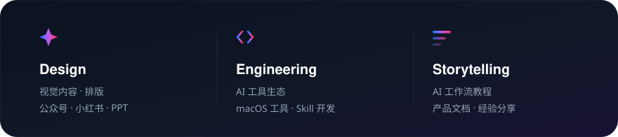
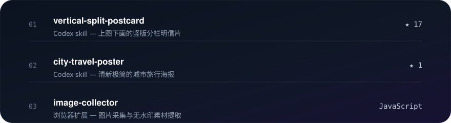
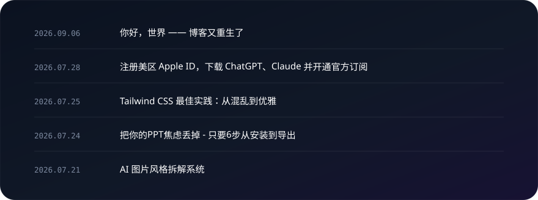

 

I build calm, useful things where **design meets AI** — AI-native workflows, macOS tools, and visual content people actually enjoy reading.

设计 × 工程 × 叙事

 

## ✦ Focus

 

## ✦ Selected Work

→ <a href="https://github.com/Nick-Job/vertical-split-postcard" style="color: inherit">vertical-split-postcard</a> · <a href="https://github.com/Nick-Job/city-travel-poster" style="color: inherit">city-travel-poster</a> · <a href="https://github.com/Nick-Job/image-collector" style="color: inherit">image-collector</a>

 

## ✦ Contributions

 

## ✦ Latest Writing

→ <a href="https://nick-space-blog.vercel.app/" style="color: inherit">nick-space-blog.vercel.app</a>

  

<a href="https://nick-space-blog.vercel.app/" style="color: inherit; text-decoration: none">Blog</a>
&nbsp;·&nbsp;
<a href="https://nick-job.github.io/" style="color: inherit; text-decoration: none">Workspace</a>
&nbsp;·&nbsp;
<a href="https://github.com/Nick-Job" style="color: inherit; text-decoration: none">GitHub</a>
&nbsp;&nbsp;—&nbsp;&nbsp; Designed by Nick · 2026

